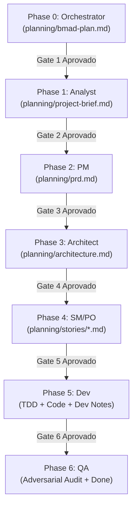

# Plano Diretor de Orquestração BMAD (Paseo Native)
**Projeto:** Guaraci Framework  
**Escopo:** Scaffolding de Endpoints CRUD na CLI & Explorador de API no Navegador (Swagger-like)  
**Autor:** `bmad-orchestrator`  
**Data:** 2026-10-19  
**Status do Plano:** Aprovado para Execução  

---

## 1. Visão Geral e Contexto de Execução

O Guaraci é um micro-framework web em Lua 5.3+/5.4 sem dependências externas (zero-dependency core), com templates `.gc` inspirados em Classic ASP, segurança orientada a conformidade (ISO 27001) e uma interface CLI (`bin/guaraci`).

O objetivo desta iniciativa contempla duas melhorias essenciais:
1. **Scaffolding de Endpoints CRUD via CLI (`guaraci`):** O framework já possui geração de rotas CRUD em tempo de execução via `src/auto_crud.lua` sobre modelos Dataware. Esta funcionalidade portará a criação de CRUD para a CLI através de um comando gerador (`guaraci generate endpoint <name>` / `scaffold`), criando deterministicamente o modelo, rotas, validações de schema e arquivos de spec de teste.
2. **Explorador de Endpoints no Navegador (Swagger-like API Explorer):** Uma interface gráfica servida no navegador que inspeciona o catálogo de rotas registradas no `router_v2` e permite que o desenvolvedor visualize contratos e dispare requisições interativas diretamente pela interface web local.

### 1.1 Regra Crítica de Repositório: Diretório `planning/` vs `docs/`
Neste repositório, o diretório `docs/` é um **submódulo git** que hospeda a wiki pública do GitHub (em português). **Nenhum artefato BMAD deve ser gravado em `docs/`**, sob pena de poluir a publicação da wiki pública. Todos os artefatos de governança e ciclo de vida BMAD residem obrigatoriamente na pasta `planning/`:
- `planning/bmad-plan.md` (Plano Diretor do Orquestrador)
- `planning/project-brief.md` (Brief do Analista)
- `planning/prd.md` (Documento de Requisitos do PM)
- `planning/architecture.md` (Especificação Técnica e ADRs do Arquiteto)
- `planning/stories/epic-X-story-Y.md` (Histórias atômicas do SM/PO)

---

## 2. Divisão de Funcionalidades no Fluxo BMAD (Feature Split)

A cadeia padrão solicitada pelo usuário (PM → PO → Developer → QA) **necessita impreterivelmente das etapas do Analista (`bmad-analyst`) e do Arquiteto (`bmad-architect`) antes do trabalho do PM e do SM/PO**.

### Por que a cadeia não pode pular o Analista e o Arquiteto?
1. **O PM necessita do Brief do Analista (`planning/project-brief.md`):** O PM não pode definir épicos e critérios de aceite funcionais no vazio sem antes groundar o escopo do problema, as restrições operacionais da CLI, os limites de ambiente (ex.: dev vs prod) e as decisões de descoberta do usuário. Pular o Analista força o PM a tomar suposições arbitrárias de domínio.
2. **O SM/PO necessita da Arquitetura (`planning/architecture.md`):** O SM/PO tem a responsabilidade estrita (Regra BMAD #4) de gerar histórias auto-contidas com *contexto técnico injetado* (schemas exatos, árvore de diretórios, ADRs de segurança, APIs de template e roteamento). Sem o Arquiteto, o PO não tem contratos de código para fatiar, o que fatalmente forçaria o Desenvolvedor a praticar "vibe-coding" (expressamente proibido pela Regra BMAD #2).

### 2.1 Matriz de Propriedade de Artefatos por Papel

| Fase | Papel Paseo | Artefato Gerado | Responsabilidade Principal |
| :--- | :--- | :--- | :--- |
| **0. Orquestração** | `bmad-orchestrator` | `planning/bmad-plan.md` | Mapeamento de estado, gates de transição, limites de escopo e prompts acionáveis. |
| **1. Descoberta** | `bmad-analyst` | `planning/project-brief.md` | Investigação de domínio, 3–5 perguntas socráticas, escopo de alto nível e restrições. |
| **2. Produto** | `bmad-pm` | `planning/prd.md` | Requisitos funcionais (FR), não-funcionais (NFR), taxonomia de comandos e Roadmap de Épicos. |
| **3. Arquitetura** | `bmad-architect` | `planning/architecture.md` | ADRs (CSP/CSRF/Sandbox), design de codegen, introspecção de rotas, schemas e layout. |
| **4. Fatiamento** | `bmad-sm-po` | `planning/stories/epic-X-story-Y.md` | Slices atômicos verticais, checklists `[ ]` e critérios de aceite com contexto técnico injetado. |
| **5. Construção** | `bmad-dev` | Código (`src/`, `bin/`, `tests/`) | Implementação orientada a testes (TDD), zero warnings no `luacheck`, notas técnicas. |
| **6. Auditoria** | `bmad-qa` | Relatório / Revisão (`## QA Findings`) | Auditoria adversarial, testes de borda, validação de segurança e aprovação formal. |

---

## 3. Portões de Fase (Phase Gates & Definition of Done)

Para garantir determinismo e integridade, nenhum papel inicia sem que os critérios de entrada sejam rigorosamente satisfeitos, e nenhum artefato é considerado concluído sem atingir sua Definição de Pronto (DoD).



### Gate 1: Transição Orchestrator → Analyst
- **Critério de Entrada:** Repositório avaliado; suíte de testes passando (`lua5.4 tests/run_all.lua`); linter limpo (`luacheck`); ausência de artefatos prévios em `planning/`.
- **Definição de Pronto (DoD Orchestrator):** `planning/bmad-plan.md` commitado na branch de trabalho contendo divisão de fases, gates, limites de escopo, questões em aberto e prompts auto-contidos.

### Gate 2: Transição Analyst → PM
- **Critério de Entrada:** `planning/project-brief.md` disponível; repositório e código existente inspecionados.
- **Definição de Pronto (DoD Analyst):** Brief contendo:
  - Visão executiva das duas features (scaffold na CLI e explorer no browser);
  - Análise dos usuários (desenvolvedor consumidor do framework);
  - 3 a 5 perguntas socráticas resolvidas ou fundamentadas;
  - Restrições essenciais (zero dependências, compatibilidade com CSP/CSRF/Sandbox do Guaraci).

### Gate 3: Transição PM → Architect
- **Critério de Entrada:** `planning/project-brief.md` aprovado.
- **Definição de Pronto (DoD PM):** `planning/prd.md` contendo:
  - Requisitos Funcionais detalhados para o gerador da CLI (sintaxe de comandos, flags de tenant, convenções de nomenclatura, saída no terminal, códigos de saída 0/1/2);
  - Requisitos Funcionais detalhados para o Explorador de API (listagem de endpoints, visualização de métodos e parâmetros, formulário de disparo de requisição, visualização de status/headers/body da resposta);
  - Requisitos Não-Funcionais (desempenho, conformidade com segurança ISO 27001, ausência de bibliotecas externas);
  - Divisão estruturada em Épicos (ex.: Épico 1: CLI Scaffolding; Épico 2: Route Introspection Engine; Épico 3: API Explorer Web Interface).

### Gate 4: Transição Architect → SM/PO
- **Critério de Entrada:** `planning/prd.md` aprovado; codebase e testes inspecionados.
- **Definição de Pronto (DoD Architect):** `planning/architecture.md` contendo:
  - **ADR 1 (CSP & Asset Delivery):** Como a interface gráfica é entregue sem violar `Content-Security-Policy: default-src 'self'` (proibição de CDNs externos e scripts inline sem controle);
  - **ADR 2 (CSRF Double-Submit no Explorer):** Como a interface web obtém e submete o cookie `guaraci_csrf_token` e o header `X-CSRF-Token` exigidos por `src/middleware_csrf.lua` para POST/PUT/DELETE/PATCH;
  - **ADR 3 (Sandbox & Template Isolation):** Como a UI é gerada evitando conflito com `src/escape_context.lua` (que bloqueia `JS_STRING` e `CSS_STRING` em templates HTML);
  - **ADR 4 (Introspecção de Rotas & OpenAPI):** Se os metadados são gerados em tempo de execução via `router_v2.get_routes()` ou estáticos via comando de build;
  - Árvore exata de novos arquivos (ex.: `src/guaraci_cli/generate.lua`, `src/guaraci_cli/templates_endpoint.lua`, rotas/handlers do explorer em `src/explorer/` ou `src/api_explorer.lua`);
  - Estrutura de arquivos gerados pelo comando (`models/<name>.lua`, `routes/<name>.lua`, `spec/<name>_spec.lua`).

### Gate 5: Transição SM/PO → Developer
- **Critério de Entrada:** `planning/architecture.md` aprovado e validado contra o PRD.
- **Definição de Pronto (DoD SM/PO):** Conjunto de histórias atômicas em `planning/stories/epic-X-story-Y.md` contendo:
  - Status inicial obrigatório: `Ready`;
  - Contexto Técnico Injetado (trechos de código, assinaturas de funções, caminhos exatos de arquivos a criar/modificar);
  - Checklist acionável de implementação (`- [ ]`);
  - Critérios de Aceite explícitos em formato Given/When/Then;
  - Comandos de validação específicos (`lua5.4 tests/...`, `luacheck ...`).

### Gate 6: Transição Developer → QA
- **Critério de Entrada:** História com status `Ready`. Nenhuma história subsequente pode ser iniciada antes do fechamento da anterior se houver dependência direta.
- **Definição de Pronto (DoD Developer):**
  - Implementação estrita do escopo da história (sem antecipar escopos futuros);
  - TDD seguido com novos testes unitários/integração;
  - 100% dos testes passando (`lua5.4 tests/run_all.lua`);
  - Zero warnings no `luacheck` (`luacheck src hooks scripts tests bin`);
  - Itens de checklist marcados com `[x]`;
  - Seção `## Dev Notes` preenchida com decisões e evidências de execução;
  - Status da história atualizado para `In Progress` / aguardando QA.

### Gate 7: Conclusão QA (Done)
- **Critério de Entrada:** História implementada pelo Developer com evidências de teste.
- **Definição de Pronto (DoD QA):**
  - Auditoria adversarial executada (injeção maliciosa, path traversal, bypass de CSRF, quebra de CSP, nomes de modelos inválidos);
  - Ausência de regressões na suíte global;
  - Seção `## QA Findings` documentada na história;
  - Status da história formalmente alterado para `Done` (ou revertido para `In Progress` com defeitos listados).

---

## 4. Fronteiras de Escopo (Scope Boundaries & Non-Goals)

Para proteger o núcleo do Guaraci e manter o framework leve, auditável e seguro, os seguintes itens estão **estritamente fora de escopo (NON-GOALS)** para esta rodada:

1. **Reescrita ou alteração invasiva do `router_v2.lua`:** O motor de correspondência e os grupos de rota (`src/route_group.lua`) são estáveis e amplamente testados. Qualquer extensão para introspecção deve ser puramente aditiva e não-bloqueante (ex.: expor metadados de rotas registradas sem quebrar assinaturas existentes).
2. **Dependências externas em tempo de execução:** É proibido adicionar módulos Luarocks, npm, binários nativos ou runtimes externos ao core do framework. O Guaraci deve continuar funcionando com interpretador puro `lua5.4` (e SQLite opcional).
3. **SPAs pesadas ou bundles JavaScript de terceiros (Swagger UI npm / React / Vue):** O explorador de API não deve importar distribuições monolíticas de Swagger UI (que pesam vários megabytes e trazem dezenas de dependências embutidas). A interface deve ser implementada em HTML5/CSS3/Vanilla JS leve, elegante, determinística e com zero dependências externas.
4. **Uso de CDNs externos:** Sob hipótese alguma scripts, estilos ou fontes devem ser carregados de `cdn.jsdelivr.net`, `cdnjs.cloudflare.com` ou similares. A política `Content-Security-Policy: default-src 'self'` impede origens externas e falha fechada.
5. **Alterações em `docs/`:** Conforme regra mandatória, o diretório `docs/` é um submódulo git da wiki e não deve sofrer alterações durante o fluxo de planejamento BMAD.
6. **Implementação de Servidor OAuth2 / Identity Provider completo:** O explorador de API destina-se a desenvolvimento e diagnóstico (`guaraci dev` ou rota protegida em staging). Autenticações complexas de terceiros estão fora de escopo.
7. **Sobrescrita destrutiva de arquivos sem confirmação:** O comando de scaffolding da CLI não pode sobrescrever arquivos existentes sem que o usuário passe explicitamente uma flag como `--force` ou recuse a operação se o arquivo já existir.

---

## 5. Questões em Aberto por Papel (Open Decisions)

### 5.1 Para o `bmad-analyst` (Descoberta)
- **UX do Scaffolding:** O comando deve ser estruturado como `guaraci generate endpoint <name>` ou `guaraci scaffold <name>`? Como o desenvolvedor passa os campos do modelo (ex.: `--fields name:string,price:number` ou interativo)?
- **Ciclo de vida do API Explorer:** O explorador de API deve ser habilitado exclusivamente no servidor de desenvolvimento (`guaraci dev`) ou deve ser um módulo integrável a qualquer aplicação Guaraci via `guaraci.enable_explorer(options)`?
- **Destino dos arquivos gerados:** O scaffold deve criar arquivos modulares separados (ex.: `models/<name>.lua`, `routes/<name>.lua`, `spec/<name>_spec.lua`) e injetar a chamada em `app.lua`, ou criar uma pasta dedicada `endpoints/<name>/`?

### 5.2 Para o `bmad-pm` (Requisitos)
- **Taxonomia da CLI e Códigos de Saída:** Padronizar códigos de saída (0 = sucesso, 1 = falha na geração/arquivo já existe, 2 = erro de sintaxe/parâmetro ausente).
- **Divisão dos Épicos:** Estabelecer o sequenciamento dos Épicos: Épico 1 (CLI Scaffolding para CRUD) e Épico 2 (Introspecção de Rotas & Interface do Explorer).
- **Especificação de Contrato da API:** O explorador deve consumir uma rota JSON interna proprietária (`GET /__guaraci/routes` ou `GET /openapi.json`) formatada no padrão OpenAPI 3.0 simplificado?

### 5.3 Para o `bmad-architect` (Arquitetura & Segurança)
- **Tensão CSP vs Scripts na Interface do Explorer:** Com `Content-Security-Policy: default-src 'self'`, scripts inline (`<script>...</script>`) sem hash/nonce são sumariamente bloqueados pelos navegadores. Como entregar o JavaScript interativo do explorer? Opções:
  - *Opção A:* Servir arquivo estático autônomo através do pipeline de arquivos estáticos do `guaraci dev` (diretório `public/`);
  - *Opção B:* Rota dedicada que serve o HTML com link para script servido sob a mesma origem com Content-Type `application/javascript`;
  - *Opção C:* Injeção dinâmica de nonce no cabeçalho CSP se servido através de rota da aplicação.
- **Tensão CSRF no Disparo de Requisições:** Métodos `POST`, `PUT`, `DELETE` e `PATCH` disparam validação no `middleware_csrf.lua`. Como a interface do explorador obtém o token CSRF válido? Deve haver um endpoint auxiliar ou o token deve ser fornecido via cookie inicial e lido pelo JS do explorador para inclusão no cabeçalho `X-CSRF-Token`?
- **Tensão de Sandbox e Template Escaping:** O parser de templates do Guaraci bloqueia contextos de string JS e CSS (`escape_context.lua` gera `blocked_context:JS_STRING`). Portanto, o explorador **não deve** tentar gerar código JS dinâmico interpolado em templates `.gc`. Deve utilizar uma página estática desacoplada que consome a API de introspecção via `fetch()` assíncrono.
- **Introspecção Estática vs Dinâmica:** O `router_v2.lua` já armazena `_routes[method] = { { pattern, param_names, handler, name } }`. O Arquiteto deve definir se uma função `router_v2.introspect()` deve ser exposta ou se um gerador de metadados em `src/api_explorer.lua` converterá esses registros em documentação interativa.
- **Mapeamento de Schemas Dataware:** Como os tipos do Dataware/Validator (`string`, `number`, `boolean`, `required`) são transformados em especificações de payload e query params no explorador.

### 5.4 Para o `bmad-sm-po` (Fatiamento de Histórias)
- Como garantir que as histórias do gerador da CLI não dependam da interface do explorer (desacoplamento total entre Épico 1 e Épico 2)?
- Critérios de teste para geração de arquivos com permissões corretas e verificações de idempotência.

### 5.5 Para o `bmad-dev` (Implementação)
- Garantir que todos os arquivos criados ou modificados cumpram rigorosamente as regras do `luacheck` (sem variáveis globais não declaradas, sem parâmetros não utilizados).
- Reutilizar utilitários existentes em `src/guaraci_cli/util.lua` (`parse_args`, `write_file`, `shell_quote`).

### 5.6 Para o `bmad-qa` (Auditoria & Segurança)
- Criação de testes de invasão que tentem injetar caracteres de escape ou caminhos relativos maliciosos (`guaraci generate endpoint ../../evil`).
- Teste de regressão garantindo que `lua5.4 scripts/smoke_cgi.lua` e `lua5.4 tests/run_all.lua` continuem 100% íntegros.

---

## 6. Prompts Prontos para Execução por Papel (Downstream Prompts)

O orquestrador da sessão deve copiar e executar cada prompt abaixo sequencialmente na respectiva sessão do agente Paseo correspondente.

---

### 6.1 Prompt para `bmad-analyst` (Fase 1: Descoberta)

```markdown
Você está atuando como bmad-analyst no framework BMAD nativo do Paseo.

Seu objetivo é conduzir a descoberta e produzir o arquivo planning/project-brief.md para duas novas funcionalidades no Guaraci:
1. Scaffolding de endpoints CRUD na CLI (geração de modelo, rota, validação e spec).
2. Explorador interativo de rotas no navegador (Swagger-like API explorer).

REGRAS DE EXECUÇÃO:
- Todos os artefatos devem ser salvos em planning/, NUNCA em docs/ (docs/ é um submódulo git reservado para a wiki pública).
- Não escreva código de aplicação.
- Inspecione antes de assumir: leia src/auto_crud.lua, src/guaraci_cli/main.lua, src/guaraci_cli/new.lua, src/router_v2.lua, hooks/security_headers.lua e CONTRIBUTING.md.
- Resolva as questões em aberto listadas na Seção 5.1 de planning/bmad-plan.md.
- Formule 3 a 5 perguntas socráticas fundamentadas no contexto do framework e apresente suas respostas e diretrizes no brief.

ENTREGA ESPERADA:
Crie planning/project-brief.md com a visão do produto, personas, objetivos, escopo, premissas e restrições técnicas (zero dependências, compatibilidade com CSP e CSRF).
Ao finalizar, atualize o usuário em pt-BR e indique a invocação de bmad-pm.
```

---

### 6.2 Prompt para `bmad-pm` (Fase 2: Requisitos & PRD)

```markdown
Você está atuando como bmad-pm no framework BMAD nativo do Paseo.

Seu objetivo é ler planning/project-brief.md e planning/bmad-plan.md e gerar o documento de requisitos do produto em planning/prd.md.

REGRAS DE EXECUÇÃO:
- Todos os artefatos residem em planning/, NUNCA em docs/.
- Não escreva código de aplicação.
- Defina Requisitos Funcionais (FRs) e Não-Funcionais (NFRs) determinísticos e verificáveis para:
  1. O comando CLI de scaffolding de endpoints CRUD (sintaxe, argumentos, flags de tenant, saída no terminal, tratamento de colisão de arquivos e códigos de saída 0, 1 e 2).
  2. O Explorador de API no navegador (descoberta de rotas, renderização visual de métodos HTTP, parâmetros de rota, envio de requisições de teste e exibição de respostas com status, headers e body formatado).
- Estruture o Roadmap em Épicos bem delimitados (ex.: Épico 1: CLI Scaffolding para Endpoints CRUD; Épico 2: Route Introspection & Schema Generation; Épico 3: Interface Web do API Explorer).

ENTREGA ESPERADA:
Grave planning/prd.md.
Ao finalizar, reporte o resultado em pt-BR e oriente o usuário a acionar o bmad-architect.
```

---

### 6.3 Prompt para `bmad-architect` (Fase 3: Arquitetura & ADRs)

```markdown
Você está atuando como bmad-architect no framework BMAD nativo do Paseo.

Seu objetivo é analisar planning/prd.md, o plano em planning/bmad-plan.md e a base de código do Guaraci para projetar a arquitetura completa em planning/architecture.md.

REGRAS DE EXECUÇÃO E RESTRIÇÕES CRÍTICAS DO REPOSITÓRIO:
- Salve o artefato exclusivamente em planning/architecture.md (nunca em docs/).
- Core sem dependências externas (zero external dependencies).
- Respeite rigorosamente a política de segurança:
  - hooks/security_headers.lua impõe 'Content-Security-Policy: default-src 'self'' e 'X-Frame-Options: DENY'. Nenhuma biblioteca JS/CSS de CDN externo pode ser usada. Scripts inline sem nonce falharão.
  - src/middleware_csrf.lua exige token double-submit (cookie + header X-CSRF-Token) para métodos mutáveis.
  - src/escape_context.lua bloqueia JS_STRING e CSS_STRING no modo HTML. A UI do explorer não deve fazer injeção dinâmica em templates .gc.
- Especifique as ADRs obrigatórias:
  1. ADR sobre entrega de assets e execução segura de JS no Explorer (conformidade CSP).
  2. ADR sobre gerenciamento do token CSRF em requisições de teste no Explorer.
  3. ADR sobre arquitetura de introspecção de rotas do router_v2.
  4. ADR sobre estrutura de templates de scaffolding na CLI (src/guaraci_cli/).
- Detalhe a árvore de novos arquivos e as modificações necessárias com assinaturas de funções e contratos de dados.

ENTREGA ESPERADA:
Grave planning/architecture.md.
Ao concluir, informe o usuário em pt-BR e recomende a invocação de bmad-sm-po.
```

---

### 6.4 Prompt para `bmad-sm-po` (Fase 4: Fatiamento de Histórias)

```markdown
Você está atuando como bmad-sm-po no framework BMAD nativo do Paseo.

Seu objetivo é ler planning/prd.md e planning/architecture.md e gerar as histórias de usuário atômicas e auto-contidas na pasta planning/stories/ (ex.: planning/stories/epic-1-story-1.md).

REGRAS DE EXECUÇÃO:
- As histórias residem em planning/stories/, NUNCA em docs/stories/.
- Cada história deve ser um slice vertical atômico e executável de forma independente.
- Regra de Ouro BMAD: Injetar todo o contexto técnico necessário (árvore de arquivos, schemas, trechos de código e assinaturas de arquitetura). O desenvolvedor JAMAIS precisará consultar o PRD completo ou adivinhar decisões arquiteturais.
- Formato obrigatório da história:
  - Título e Identificador (ex.: Story 1.1: CLI Endpoint Command Parser & Templates);
  - Status inicial: Ready;
  - Descrição da História (Como / Quero / Para);
  - Contexto Técnico Injetado (ADRs relevantes, arquivos exatos a tocar, funções a chamar);
  - Checklist de Implementação detalhado (- [ ]);
  - Critérios de Aceite (Given / When / Then);
  - Instruções de Validação de Teste e Linter (comandos exatos a executar).

ENTREGA ESPERADA:
Crie as histórias em planning/stories/ com status 'Ready'.
Ao finalizar, liste em pt-BR o catálogo de histórias criadas e indique o início da implementação com bmad-dev na primeira história.
```

---

### 6.5 Prompt para `bmad-dev` (Fase 5: Implementação de História)

```markdown
Você está atuando como bmad-dev no framework BMAD nativo do Paseo.

Sua tarefa atual é implementar EXCLUSIVAMENTE a história atribuída:
História: planning/stories/epic-{X}-story-{Y}.md

REGRAS DE EXECUÇÃO (BMAD Law #2 & #5):
- Leia APENAS a história atribuída e os arquivos de código por ela referenciados. Não leia o PRD ou outras histórias.
- Não altere o escopo nem implemente funcionalidades de histórias futuras ("No Vibe-Coding").
- Pratique TDD: escreva ou atualize os testes de especificação antes ou junto com a implementação.
- Mantenha 100% dos testes passando: 'lua5.4 tests/run_all.lua' deve exibir 'ALL SPECS PASSED'.
- Mantenha zero advertências no linter: 'PATH=$PATH:/home/edgar/.luarocks/bin luacheck src hooks scripts tests bin' deve retornar 0 warnings / 0 errors.
- Ao concluir a codificação:
  1. Marque os itens do checklist da história como executados (- [x]).
  2. Adicione a seção '## Dev Notes' no final da história descrevendo as alterações e os comandos de teste executados.
  3. Mude o status da história de 'Ready' para 'In Progress' (aguardando QA).

ENTREGA ESPERADA:
Código e testes implementados, linter verificado e história atualizada com Dev Notes.
Ao terminar, comunique em pt-BR e instrua o usuário a acionar bmad-qa para auditar a história.
```

---

### 6.6 Prompt para `bmad-qa` (Fase 6: Auditoria Adversarial)

```markdown
Você está atuando como bmad-qa no framework BMAD nativo do Paseo.

Sua tarefa é auditar de forma adversarial a implementação da história:
História: planning/stories/epic-{X}-story-{Y}.md

REGRAS DE EXECUÇÃO:
- Analise as alterações de código feitas pelo bmad-dev contra a história e planning/architecture.md.
- Procure ativamente por:
  - Vulnerabilidades de segurança (injeção, path traversal em parâmetros da CLI, bypass de CSRF/CSP no explorer);
  - Casos de borda não tratados (valores nulos, strings vazias, arquivos já existentes, erros 500 não mascarados);
  - Violações de estilo ou dependências adicionadas inadvertidamente.
- Execute a suíte de testes completa ('lua5.4 tests/run_all.lua') e o linter ('PATH=$PATH:/home/edgar/.luarocks/bin luacheck src hooks scripts tests bin').
- Registre suas observações na seção '## QA Findings' da história.
- Se tudo estiver em total conformidade, atualize o status da história para 'Done'.
- Se encontrar falhas ou riscos, descreva os defeitos e alterne o status para 'In Progress', indicando que o bmad-dev deve corrigir os pontos.

ENTREGA ESPERADA:
História atualizada com '## QA Findings' e status definitivo ('Done' ou 'In Progress').
Comunique o resultado detalhado em pt-BR para o usuário.
```

---

## 7. Painel de Status do Projeto & Próxima Ação

### 📊 BMAD Project Status

```
┌──────────────────────┬────────────────────────────────┬────────────┬─────────────────────────────┐
│ Papel BMAD           │ Artefato Esperado              │ Status     │ Observações                 │
├──────────────────────┼────────────────────────────────┼────────────┼─────────────────────────────┤
│ bmad-orchestrator    │ planning/bmad-plan.md          │ Concluído  │ Plano diretor aprovado      │
│ bmad-analyst         │ planning/project-brief.md      │ Pendente   │ Próximo papel a executar    │
│ bmad-pm              │ planning/prd.md                │ Bloqueado  │ Aguarda Brief do Analista   │
│ bmad-architect       │ planning/architecture.md       │ Bloqueado  │ Aguarda PRD do PM           │
│ bmad-sm-po           │ planning/stories/*.md          │ Bloqueado  │ Aguarda Arquitetura         │
│ bmad-dev             │ Código / Testes em src/ & spec │ Bloqueado  │ Aguarda Histórias Ready     │
│ bmad-qa              │ Auditoria Adversarial          │ Bloqueado  │ Aguarda Implementação Dev   │
└──────────────────────┴────────────────────────────────┴────────────┴─────────────────────────────┘
```

### 🎯 Next Recommended Action

O planejamento da orquestração está consolidado e commitado no repositório. Todos os portões de fase foram formalizados.

A próxima etapa obrigatória do fluxo BMAD é inicializar o papel de Descoberta:
**Invocar o agente Paseo `bmad-analyst`** fornecendo o prompt pronto da **Seção 6.1** deste documento para gerar o arquivo `planning/project-brief.md`.
