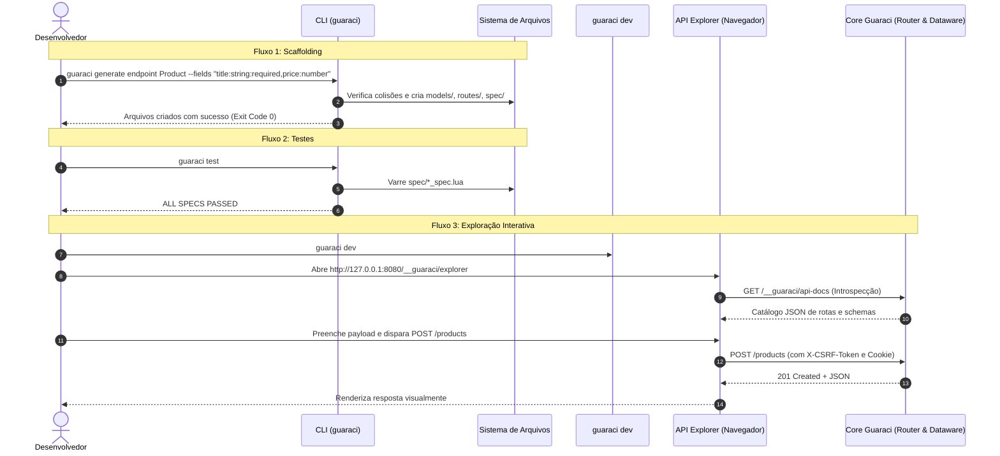

# Project Brief: Scaffolding de Endpoints CRUD & API Explorer no Navegador

**Projeto:** Guaraci Framework  
**Fase BMAD:** 01 - Descoberta e Análise Técnica (Discovery)  
**Papel:** `bmad-analyst` (Mary)  
**Data:** 2026-10-19  
**Status:** Concluído / Pronto para Avaliação do `bmad-pm`  

---

## 1. Visão Executiva & Declaração do Problema (Executive Vision & Problem Statement)

### 1.1 Contexto Geral
O **Guaraci** é um micro-framework web para Lua 5.3+/5.4 sem dependências externas no runtime (zero-dependency core), construído sob os princípios de simplicidade ("zero-magic"), auditabilidade e segurança por design (ISO 27001). Possui suporte nativo a templates no estilo Classic ASP (`.gc`), roteamento explícito com parâmetros de rota (`router_v2.lua`), camada de dados e modelos relacionais (`dataware.lua`), motor de validação/binding tipado (`validator.lua`, `binder.lua`), proteções rigorosas contra vulnerabilidades web (CSP estrito, CSRF double-submit, sandboxing de templates) e uma CLI extensível (`bin/guaraci`).

Atualmente, o framework oferece geração de CRUD em tempo de execução através do módulo `src/auto_crud.lua`, permitindo registrar endpoints REST de paginação, consulta, criação, atualização e exclusão sobre modelos Dataware. Contudo, faltam duas capacidades essenciais para elevar a produtividade do desenvolvedor e acelerar o ciclo de desenvolvimento:

### 1.2 Problema 1: Falta de Scaffolding de Recursos CRUD na CLI
- **Sintoma:** Para criar um novo recurso na aplicação, o desenvolvedor precisa criar manualmente múltiplos arquivos desacoplados: o modelo Dataware em `models/`, o arquivo de rotas com bindings e validações em `routes/`, e os testes unitários/integrados em `spec/`.
- **Impacto:** O processo é repetitivo, lento e sujeito a erros humanos (ex.: esquecer regras de validação, ignorar contratos de isolamento multi-tenant, ou não seguir as convenções de testes do `guaraci test`).
- **Objetivo da Solução:** Criar um gerador de código na CLI (`guaraci generate endpoint <name>` / `guaraci scaffold <name>`) que produza deterministicamente os artefatos do recurso (`models/<name>.lua`, `routes/<name>.lua` e `spec/<name>_spec.lua`) a partir de parâmetros informados na linha de comando, integrando-se nativamente com a suíte de testes existente.

### 1.3 Problema 2: Ausência de um Explorador de API Interativo (Swagger-like) no Navegador
- **Sintoma:** O desenvolvedor não possui uma forma visual rápida de inspecionar as rotas registradas no `router_v2`, entender os parâmetros esperados e disparar requisições HTTP de teste sem recorrer a ferramentas externas (cURL, Postman, Insomnia) ou bibliotecas pesadas de terceiros (Swagger UI npm/CDN).
- **Impacto:** Fricção no ciclo de feedback local durante o desenvolvimento (`guaraci dev`) e dependência de ferramentas fora da stack Lua. Adicionalmente, adotar ferramentas convencionais de documentação web violaria as políticas estritas de segurança do Guaraci (CSP `default-src 'self'`, bloqueio de CDNs e restrições de injeção em templates).
- **Objetivo da Solução:** Fornecer uma interface gráfica web embutida, leve (<50KB), sem CDNs e sem dependências externas, que inspecione em tempo de execução o catálogo de rotas do `router_v2` e os schemas do `dataware`, permitindo visualizar contratos e disparar requisições interativas (GET, POST, PUT, DELETE, PATCH) com suporte automático ao fluxo de tokens CSRF.

---

## 2. Público-Alvo & Fluxos Principais de Usuário (Target Audience & Core User Flows)

### 2.1 Personas
1. **Desenvolvedor de Aplicações Lua (App Developer):** Utiliza o Guaraci para construir APIs REST e serviços web. Busca alta produtividade, comandos rápidos de scaffolding e ciclo de feedback imediato sem configurar ferramentas complexas.
2. **Arquiteto de Software / Especialista em Segurança (SecOps / Lead Architect):** Preza pela conformidade com ISO 27001, ausência de dependências ocultas, manutenção de headers CSP defensivos e garantia de que ferramentas de desenvolvimento não vazem informações sensíveis ou vetores de ataque em ambiente de produção.
3. **Engenheiro de QA / Testes:** Necessita de testes automatizados prontos gerados junto com o código para garantir cobertura contínua e regressão zero na CLI (`guaraci test`).

### 2.2 Fluxo de Usuário 1: Geração de Recurso CRUD via CLI
```
[Terminal]
  1. Desenvolvedor executa:
     guaraci generate endpoint Product --fields "title:string:required,price:number,stock:integer"
  2. CLI valida o nome do recurso e os tipos de campos contra o catálogo do validator.lua.
  3. CLI verifica se os arquivos de destino já existem (se existirem e --force não for passado, aborta com erro 1).
  4. CLI gera deterministicamente:
     - models/product.lua (schema tipado, primary key, regras de validação)
     - routes/product.lua (rotas REST com listagem paginada, get por ID, create, update e delete)
     - spec/product_spec.lua (testes Busted-like cobrindo status 200, 201, 400, 404 e isolamento)
  5. CLI exibe mensagem de sucesso com instruções claras de integração em app.lua.
```

### 2.3 Fluxo de Usuário 2: Validação Automatizada Imediata
```
[Terminal]
  1. Desenvolvedor executa:
     guaraci test
  2. O spec_runner do Guaraci descobre o arquivo spec/product_spec.lua recém-criado.
  3. A suíte executa e valida o contrato das rotas geradas contra um banco SQLite em memória.
  4. Terminal exibe: "Running N spec file(s)... ALL SPECS PASSED".
```

### 2.4 Fluxo de Usuário 3: Exploração e Teste Interativo de Rotas no Navegador
```
[Navegador & Servidor Local]
  1. Desenvolvedor inicia o servidor:
     guaraci dev
  2. Desenvolvedor acessa: http://127.0.0.1:8080/__guaraci/explorer
  3. A interface web Vanilla HTML/JS solicita os metadados de rotas via GET /__guaraci/api-docs (JSON).
  4. O servidor inspeciona router_v2 e os modelos registrados no dataware, retornando a árvore de rotas e schemas.
  5. A interface renderiza visualmente os endpoints agrupados por método HTTP (GET, POST, PUT, DELETE, PATCH).
  6. O desenvolvedor seleciona "POST /products", preenche o formulário gerado com base no schema do modelo e clica em "Send Request".
  7. O cliente JavaScript obtém transparentemente o token CSRF (cookie guaraci_csrf_token) e injeta o header X-CSRF-Token.
  8. O servidor processa a requisição, persiste os dados no SQLite e responde status 201 Created.
  9. A interface exibe status code, headers de resposta e corpo JSON formatado em tempo real.
```

### 2.5 Diagrama Geral de Fluxos


---

## 3. Restrições Técnicas & Contexto Atual do Repositório (Technical Constraints & Current Context)

Para manter a integridade arquitetural do Guaraci, qualquer proposta deve respeitar estritamente as regras de fundação do repositório:

1. **Zero Runtime Dependencies (Core Desacoplado):**
   - O core do framework não pode introduzir módulos externos via LuaRocks ou gerenciadores nativos. Apenas `lsqlite3` é opcional (driver SQLite para Dataware) e `luasocket` é opcional (apenas para o servidor embutido `guaraci dev`).
   - O gerador de código na CLI e o API Explorer devem rodar exclusivamente sobre o interpretador padrão `lua5.4` / `lua5.3` e as bibliotecas padrão do sistema.
2. **Segurança ISO 27001 & Cabeçalhos Estritos (`hooks/security_headers.lua`):**
   - A resposta HTTP de qualquer requisição servida pelo framework aplica:
     - `Content-Security-Policy: default-src 'self'`
     - `X-Frame-Options: DENY`
     - `X-Content-Type-Options: nosniff`
     - `Strict-Transport-Security: max-age=31536000; includeSubDomains`
   - **Implicação Direta no Explorer:** Nenhum script, folha de estilo ou fonte pode ser carregada de CDNs externos (ex.: `cdnjs`, `jsdelivr`, `unpkg`, Google Fonts). Scripts inline (`<script>...</script>`) sem hashes/nonces falharão fechados. Toda a interface web deve ser servida sob a mesma origem com Content-Type explícito.
3. **Proteção CSRF Double-Submit (`src/middleware_csrf.lua`):**
   - Para métodos mutáveis (`POST`, `PUT`, `PATCH`, `DELETE`), o middleware exige que o cabeçalho `X-CSRF-Token` coincida exatamente com o cookie `guaraci_csrf_token` (comprimento mínimo de 16 caracteres).
   - **Implicação Direta no Explorer:** O disparo de requisições de teste pelo navegador a partir da interface gráfica falhará com status 403 (`csrf_token_invalid`) a menos que o cliente JS do Explorer gerencie e propague o token de forma segura e transparente.
4. **Isolamento de Sandbox & Restrições de Template (`src/escape_context.lua`):**
   - O motor de renderização `.gc` bloqueia injeções em contextos JS e CSS (`blocked_context:JS_STRING` e `blocked_context:CSS_STRING`).
   - **Implicação Direta no Explorer:** A interface web do explorer **não deve** tentar gerar código JS dinamicamente interpolado dentro de templates `.gc`. Deve utilizar uma estrutura estática desacoplada que consulte os dados via API JSON assíncrona (`fetch()`).
5. **Ciclo de Vida de Execução (CGI vs Long-Lived Dev Server):**
   - Em produção via CGI (`adapter_cgi.lua`), cada requisição é um processo novo isolado.
   - No `guaraci dev`, o processo do servidor é persistente, mas o estado da aplicação é completamente recarregado a cada requisição (`reset_app_state()`), limpando rotas (`router_v2.clear()`), middlewares e modelos (`guaraci.clear_models()`).
   - O API Explorer deve coexistir de forma limpa com esse mecanismo de recarga do `guaraci dev`.
6. **Mecanismo de Descoberta de Testes (`src/guaraci_cli/test.lua`):**
   - O comando `guaraci test` utiliza `find <dir> -maxdepth 1 -name '*_spec.lua'` sobre as pastas `spec/` ou `tests/`.
   - **Implicação Direta no Scaffolding:** Os arquivos de especificação gerados devem residir obrigatoriamente na raiz de `spec/` (ex.: `spec/product_spec.lua`), pois estruturas aninhadas (ex.: `spec/endpoints/product/spec.lua`) não seriam descobertas pela CLI.

---

## 4. Fronteiras de Escopo (Out of Scope / Non-Goals)

Para proteger a integridade do código e evitar dispersão de esforço, os seguintes tópicos estão **estritamente fora de escopo**:

1. **Reescrita do Motor do `router_v2.lua`:** O mecanismo de correspondência de rotas e grupos (`route_group.lua`) não deve sofrer alterações em sua lógica central de resolução. A introspecção deve ser aditiva (apenas funções de leitura/exposição de rotas).
2. **SPAs Pesadas ou Bundles de Terceiros (Swagger UI npm / React / Vue):** Proibido embarcar distribuições pesadas de Swagger UI ou frameworks JavaScript com bundles de centenas de kilobytes e dependências npm. A interface será desenvolvida em HTML5 semântico, CSS3 e Vanilla JS moderno (<50KB total).
3. **Uso de CDNs Remotos:** Proibido carregar bibliotecas ou ícones de origens remotas. Viola a CSP padrão e os preceitos de privacidade e conformidade ISO 27001.
4. **Alterações no Submódulo `docs/`:** O diretório `docs/` é um submódulo git exclusivo da wiki pública e não deve receber artefatos do ciclo BMAD. Todos os documentos residem em `planning/`.
5. **Autenticação Complexa / Identity Provider no Explorer:** O explorer destina-se a desenvolvimento local e diagnóstico em staging. Recursos complexos como fluxo OAuth2 Authorization Code, SSO corporativo ou gestão de RBAC avançado dentro do explorer estão fora de escopo.
6. **Sobrescrita Destrutiva sem Confirmação:** O gerador CLI nunca deve sobrescrever arquivos existentes sem a passagem explícita da flag `--force`. Em caso de colisão, a CLI deve recusar a operação e sair com código de erro 1.
7. **Novo Motor de CRUD em Runtime:** O projeto não irá reescrever `auto_crud.lua`. O objetivo da CLI é gerar código fonte legível e modular, utilizando as capacidades já consolidadas do `dataware.lua` e `validator.lua`.

---

## 5. Perguntas Socráticas de Descoberta & Respostas Recomendadas (Socratic Questioning)

Como analista técnico, formulei 5 perguntas socráticas de alto impacto fundamentadas nas restrições reais do repositório, apresentando a análise técnica e a decisão recomendada:

### Pergunta Socrática 1: Injeção Automática em `app.lua` vs. Registro Modular Explícito
* **Pergunta:** O comando gerador da CLI deve tentar modificar cirurgicamente o arquivo `app.lua` existente para registrar as novas rotas, ou deve manter `app.lua` intacto e emitir a instrução de fiação (wiring) no stdout?
* **Análise Técnica:** Tentar fazer injeção automática de código ("monkey patching") em arquivos de código do usuário via expressões regulares em Lua é frágil, imprevisível e sujeito a corrupção de sintaxe caso o desenvolvedor utilize uma estrutura personalizada de inicialização. Viola o princípio "zero-magic" do Guaraci.
* **Decisão / Recomendação:** O comando gerador deve operar de forma **estritamente aditiva**, gerando os arquivos `models/<name>.lua`, `routes/<name>.lua` e `spec/<name>_spec.lua` sem tocar em `app.lua`. Ao concluir com sucesso, a CLI imprime no terminal o snippet exato de código (2 linhas) necessário para montar a rota em `app.lua` (ex.: `require("routes.<name>")(guaraci.router())`). No futuro, pode-se suportar convenção de auto-loading de diretório, mas sem reescrever arquivos de usuário silenciosamente.

### Pergunta Socrática 2: Scaffolding como Wrapper de `auto_crud` vs. Handlers CRUD Explícitos Gerados
* **Pergunta:** O arquivo gerado em `routes/<name>.lua` deve ser apenas um wrapper delegando para `auto_crud.generate(model, router)` ou deve expandir os handlers REST (`router.get`, `router.post`, `router.put`, `router.delete`) de forma legível e customizável?
* **Análise Técnica:** Se a CLI apenas gerar uma chamada `model:auto_crud(router)`, o desenvolvedor ganha pouca vantagem em relação a invocar `model:auto_crud` manualmente. O verdadeiro valor de um scaffold (inspirado em ecossistemas maduros como Rails e Phoenix) reside em disponibilizar código-fonte claro e auditável que o desenvolvedor possa personalizar imediatamente (ex.: adicionar um filtro de busca específico, interceptar uma validação ou disparar um log customizado).
* **Decisão / Recomendação:** O gerador deve produzir um módulo de rota modular explícito que declare os handlers padrão (`list`, `get`, `create`, `update`, `delete`) utilizando os contratos de resposta JSON, validação de schema via `validator.schema` e binding via `binder.bind`, aproveitando as consultas do `model` Dataware. Opcionalmente, pode-se fornecer uma flag `--auto-crud` para quem deseja apenas a delegação em tempo de execução.

### Pergunta Socrática 3: Arquitetura de Entrega de Assets do API Explorer sob CSP Estrito (`default-src 'self'`)
* **Pergunta:** Como servir a interface web interativa do API Explorer sem violar a política `Content-Security-Policy: default-src 'self'`, sem usar CDNs externos e sem sofrer bloqueio do sandbox de templates (`escape_context.lua` gera `blocked_context:JS_STRING`)?
* **Análise Técnica:** O hook de segurança padrão (`hooks/security_headers.lua`) rejeita conexões para domínios externos e navegadores modernos bloqueiam scripts inline não assinados. Além disso, a tentativa de interpolar variáveis dentro de blocos `<script>` em templates `.gc` é explicitamente bloqueada pelo compilador de templates do Guaraci.
* **Decisão / Recomendação:** O API Explorer deve ser arquitetado como uma aplicação web estática autônoma servida sob rotas dedicadas da mesma origem com tipos MIME adequados:
  - `GET /__guaraci/explorer` -> Retorna o HTML base (`text/html; charset=utf-8`);
  - `GET /__guaraci/explorer/app.js` -> Retorna o script cliente Vanilla JS (`application/javascript; charset=utf-8`);
  - `GET /__guaraci/explorer/style.css` -> Retorna os estilos CSS elegantes (`text/css; charset=utf-8`);
  - `GET /__guaraci/api-docs` -> Retorna os metadados JSON das rotas e modelos (`application/json; charset=utf-8`).
  Os arquivos estáticos do explorer residem no pacote do framework (ex.: `src/api_explorer/ui/`) e são servidos diretamente pelo handler em memória ou via string embutida, garantindo 100% de conformidade com a CSP local e zero dependência de arquivos externos.

### Pergunta Socrática 4: Mecanismo de Emissão e Envio do Token CSRF no API Explorer
* **Pergunta:** Como o API Explorer permite ao desenvolvedor disparar requisições `POST`, `PUT`, `DELETE` e `PATCH` contra endpoints protegidos pelo `middleware_csrf.lua` sem ser sumariamente bloqueado com status 403?
* **Análise Técnica:** O middleware de CSRF do Guaraci inspeciona requisições mutáveis exigindo o cookie `guaraci_csrf_token` e o header `X-CSRF-Token` com tamanho >= 16 e valores idênticos. Se o desenvolvedor disparar um POST pelo navegador sem esse par, a requisição falha.
* **Decisão / Recomendação:** Ao carregar a página `GET /__guaraci/explorer`, o endpoint do explorer gera automaticamente um token CSRF seguro (utilizando `guaraci_random.hex(16)`) e o envia no cabeçalho `Set-Cookie: guaraci_csrf_token=<token>; Path=/; SameSite=Lax`. O JavaScript do Explorer lê esse cookie (ou o obtém do payload JSON de metadados) e anexa automaticamente o cabeçalho `X-CSRF-Token: <token>` em todas as requisições `fetch()` mutáveis geradas a partir da interface. Isso assegura testes perfeitos no ambiente de desenvolvimento com respeito integral às defesas de segurança.

### Pergunta Socrática 5: Modelo de Introspecção do `router_v2` e Detalhamento de Contrato de Payload
* **Pergunta:** O `router_v2` atual armazena em `_routes[method]` apenas `pattern`, `param_names`, `lua_pattern`, `handler` e `name`. Como o Explorer saberá quais parâmetros de consulta e quais campos de corpo (JSON body) são esperados para cada endpoint?
* **Análise Técnica:** Inspecionar o closure de um `handler` em Lua para inferir tipos de parâmetros em tempo de execução é inviável sem reflexão pesada de bytecode. Porém, o Guaraci já possui o registro central de modelos em `guaraci.list_models()` / `dataware.get(name):info()`, que armazena a tabela de schema com os tipos de cada campo (`string`, `number`, `boolean`, `required`).
* **Decisão / Recomendação:** O motor de introspecção (`src/api_explorer.lua`) deve cruzar as informações do `router_v2.get_routes()` com o catálogo de modelos do `dataware`. Para rotas cujo padrão segue a convenção do recurso (ex.: `/products`, `/products/:id`), os campos e tipos definidos no schema do modelo são mapeados para documentar os parâmetros de path, query params e payload JSON esperado. Para rotas avulsas, o explorer exibe a assinatura de parâmetros de rota `:param` extraídos diretamente do padrão e disponibiliza um editor de corpo JSON genérico.

---

## 6. Decisões Tomadas (Decisions Taken)

Em cumprimento à Seção 5.1 do Plano Diretor (`planning/bmad-plan.md`), as seguintes decisões técnicas e de design foram tomadas:

1. **Formato do Comando de Scaffolding:**
   - **Decisão:** Comando primário `guaraci generate endpoint <name>` com alias conveniente `guaraci scaffold <name>`.
   - **Justificativa:** Adota o padrão extensível de geradores (`generate <tipo>`) para futuras expansões do framework mantendo compatibilidade com comandos diretos.
2. **Sintaxe de Definição de Campos:**
   - **Decisão:** Flag declarativa `--fields "campo:tipo[:regra],..."` (ex.: `--fields "name:string:required,price:number,stock:integer"`), não-interativa.
   - **Justificativa:** Garante execução idempotente e determinística em scripts e pipelines de CI/CD sem bloquear o terminal por prompts interativos.
3. **Ciclo de Vida e Ativação do API Explorer:**
   - **Decisão:** Ativado automaticamente por padrão no servidor de desenvolvimento (`guaraci dev`) e exportável como módulo programático via `guaraci.enable_explorer(router, options)` para ambientes como staging.
   - **Justificativa:** Oferece conveniência imediata ("zero-config") em desenvolvimento local e flexibilidade de montagem em servidores de teste.
4. **Proteção de Produção para o API Explorer (Fail-Closed):**
   - **Decisão:** O Explorer é desabilitado por padrão se `env == "prod"` ou `GUARACI_ENV=prod`, exigindo a flag explícita `force_production = true` para ser montado em produção.
   - **Justificativa:** Previne vazamento de rotas e superfícies de ataque em conformidade com ISO 27001.
5. **Layout de Destino dos Arquivos Gerados:**
   - **Decisão:** Estrutura modular desacoplada: `models/<name>.lua`, `routes/<name>.lua` e `spec/<name>_spec.lua`.
   - **Justificativa:** Respeita o padrão de busca do `guaraci test` (`spec/*_spec.lua` com `-maxdepth 1`) e segue a separação clássica de responsabilidades em Lua.
6. **Integridade de `app.lua` sem Injeção Destrutiva:**
   - **Decisão:** A CLI não altera `app.lua` automaticamente; emite as instruções de inclusão no stdout ao concluir a geração.
   - **Justificativa:** Evita corrupção acidental de sintaxe em projetos brownfield e preserva o princípio "zero-magic".
7. **Tratamento de Colisão de Arquivos:**
   - **Decisão:** A CLI aborta com código de saída 1 se qualquer um dos arquivos já existir, a menos que `--force` seja explicitamente passado.
   - **Justificativa:** Evita sobrescrita acidental de código pré-existente do desenvolvedor.

---

## 7. Riscos & Premissas (Risks & Assumptions)

### 7.1 Riscos Mapeados & Mitigações
| Risco Identificado | Severidade | Estratégia de Mitigação |
| :--- | :--- | :--- |
| **Exposição Acidental do Explorer em Produção:** Risco de expor catálogo de endpoints e testes interativos para usuários externos na web. | **Alta** | Implementação de trava *fail-closed* baseada na variável de ambiente `GUARACI_ENV` e no parâmetro `options.env`. Bloqueio com status 404/403 a menos que `force_production = true` seja configurado. |
| **Bloqueio de CSP no Navegador:** Navegador bloquear scripts do explorer caso algum estilo ou script inline seja introduzido acidentalmente. | **Média** | Modularização de todo o código da UI em arquivos dedicados servidos sob a mesma origem com Content-Type estrito e ausência de atributos `onclick` ou estilos inline. |
| **Injeção de Path Traversal na CLI:** Usuário fornecer nomes de recursos maliciosos como `../../etc/passwd` no comando de geração. | **Alta** | Reutilizar e reforçar a validação de nomes já adotada em `guaraci new`: regex estrita `^[%w][%w_%-]*$`, rejeição de barras e sequências `..`. |
| **Colisão de Nomes de Rota / Modelo:** Geração de um recurso com nome de modelo já existente no Dataware. | **Baixa** | Checagem de existência prévia no sistema de arquivos e suporte a `--force`. |

### 7.2 Premissas de Execução
1. O desenvolvedor executa os comandos na raiz de um projeto Guaraci válido (contendo `app.lua`).
2. O ambiente possui `lua5.4` (ou `lua5.3`) acessível no `PATH`.
3. Os diretórios do projeto possuem permissão de escrita para criação de novos arquivos nas pastas `models/`, `routes/` e `spec/`.
4. O servidor `guaraci dev` continuará sendo utilizado primariamente em ambiente de desenvolvimento local (`127.0.0.1` / `localhost`).

---

## 8. Questões em Aberto para o Product Manager (Open Questions for the PM)

As seguintes questões de negócio e estratégia de produto não podem ser deduzidas exclusivamente da inspeção do código-fonte e requerem definição do `bmad-pm`:

1. **Padronização da Rota Padrão do Explorer:**
   - *Opção A:* Utilizar o namespace interno de framework `GET /__guaraci/explorer` (evita qualquer colisão com rotas de negócio da aplicação).
   - *Opção B:* Adotar um caminho amigável público como `GET /api-docs` ou `GET /explorer`.
   - *Recomendação do Analista:* Adotar `/__guaraci/explorer` como padrão do framework, com parâmetro opcional `path = "/api-docs"` configurável via `guaraci.enable_explorer({ path = "..." })`.
2. **Formato do Contrato de Exportação de Metadados:**
   - *Opção A:* Formato proprietário simplificado do Guaraci (`GET /__guaraci/api-docs` retornando lista de rotas, métodos e schema Dataware).
   - *Opção B:* Especificação oficial OpenAPI 3.0 simplificada (`GET /openapi.json`), permitindo exportar o arquivo e importar diretamente no Postman/Insomnia/Swagger Editor.
   - *Recomendação do Analista:* O endpoint pode fornecer o schema OpenAPI 3.0 simplificado nativamente, que atende tanto a UI embarcada quanto ferramentas externas do ecossistema.
3. **Tratamento de Multi-Tenancy Padrão no Scaffolding:**
   - *Opção A:* Todo modelo gerado herda `require_tenant = true` (padrão atual do `dataware.lua`), exigindo header de tenant nas requisições.
   - *Opção B:* Permitir a flag `--no-tenant` na CLI para gerar recursos públicos/globais que não exigem tenant.
   - *Recomendação do Analista:* Suportar a flag `--no-tenant` (ou `--tenant=false`) na CLI, mantendo multi-tenancy habilitado por padrão para seguir a convenção de segurança do Dataware.

---

## 9. Próximos Passos & Handoff para o `bmad-pm`

Com a entrega deste `planning/project-brief.md`, o **Portão de Fase 1 (Gate 1: Descoberta)** está completamente concluído.

O próximo papel a ser acionado pelo orquestrador é o **`bmad-pm` (Fase 2: Requisitos e PRD)**, utilizando o prompt da **Seção 6.2** de `planning/bmad-plan.md` para produzir `planning/prd.md`.
